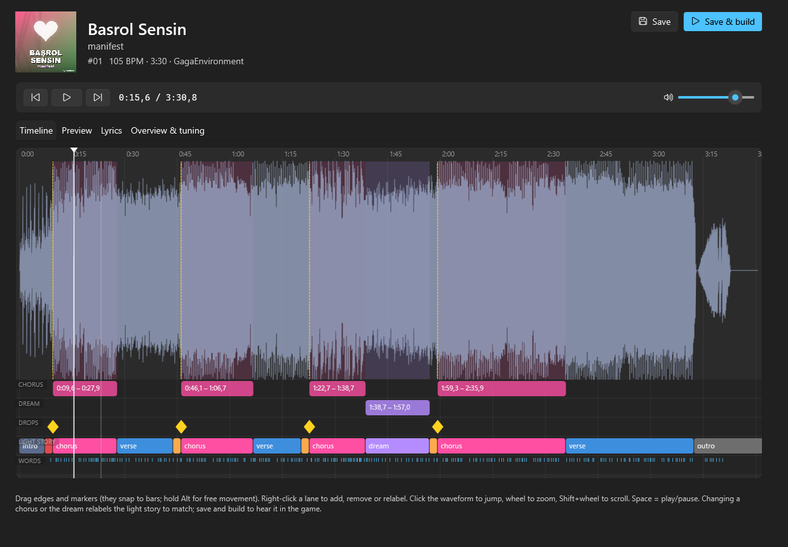
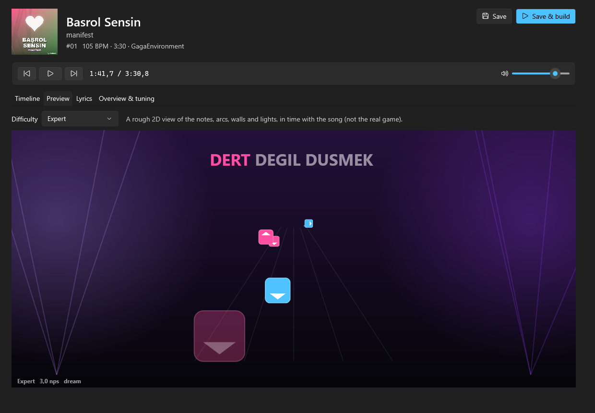
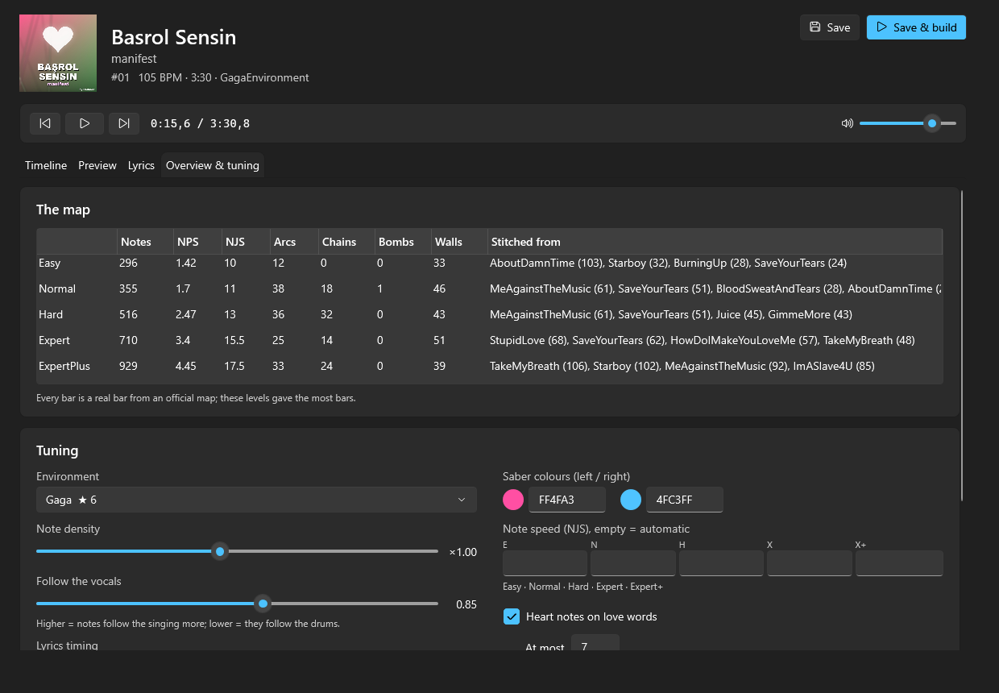
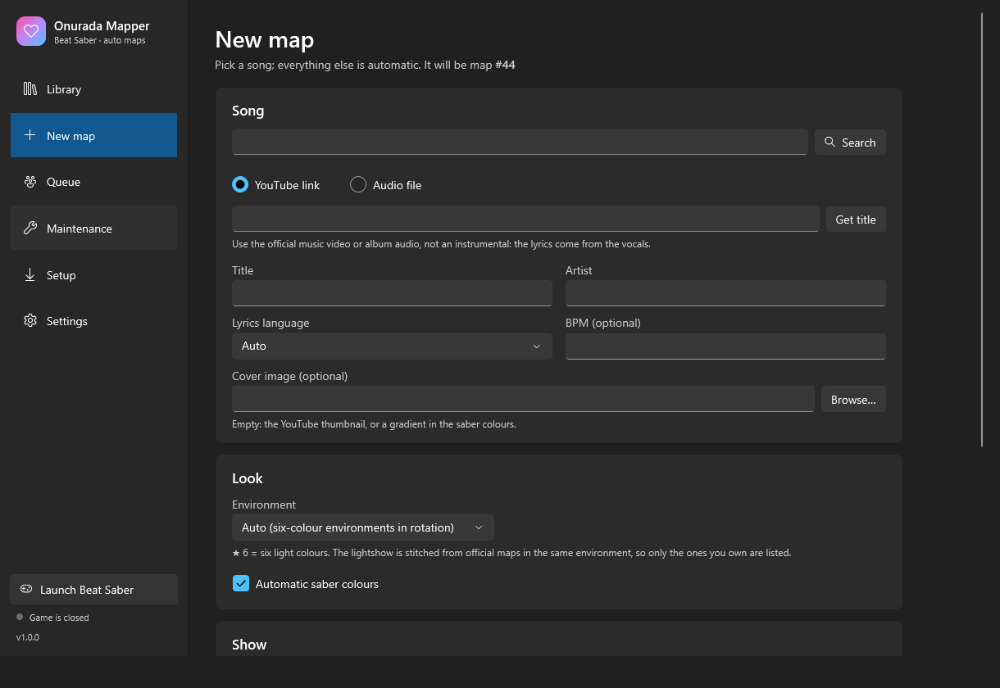
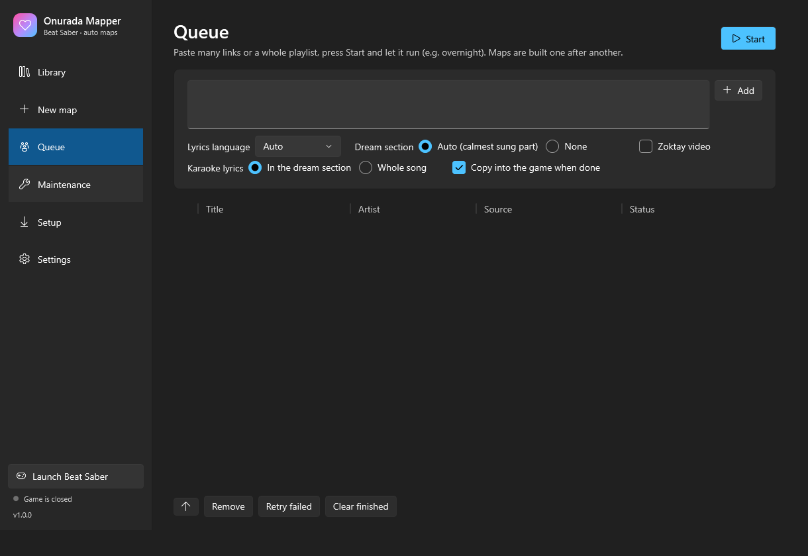

<p align="center"></p>

<h1 align="center">Onurada Mapper</h1>

<p align="center"><b>Paste a YouTube link, get a full Beat Saber map:</b> notes for five difficulties, a lightshow, karaoke lyrics, a dream section with a video in the sky, heart notes and pink dust.</p>

<p align="center"><a href="#türkçe">Türkçe</a> · <a href="#english">English</a></p>



---

## English

### What it does

Onurada Mapper is a Windows app that turns any song into a custom Beat Saber level, start to finish:

1. **Gets the song.** You can paste a YouTube link, search YouTube inside the app, drop an audio file on the window, or paste a whole playlist into the queue.
2. **Splits it into vocals, drums, bass and the rest** with [demucs](https://github.com/facebookresearch/demucs). Then it finds the tempo, the beats and the song sections.
3. **Writes down the lyrics** with [faster-whisper](https://github.com/SYSTRAN/faster-whisper) (large-v3). Each word is then aligned to the vocals (torchaudio MMS forced alignment).
4. **Finds the story of the song:** choruses, drops, the calmest sung part (the *dream section*) and the light-story segments. Optionally it can also find where one particular singer sings, by voice.
5. **Builds the notes from real official maps.** Each bar is a bar from an official Beat Saber map. A beam search picks bars that fit the song's drums and vocals, then checks flow and parity. The lightshow is stitched together the same way, from official lightshows in the same environment.
6. **Copies the level into your game.** It backs up whatever was there first.

Everything happens on your own PC. Steps 2–5 take about 3–6 minutes per song on an NVIDIA GPU.

### Features

| | |
|---|---|
| **New map** | YouTube search, link or file, auto title/artist, lyrics language, environment (★ = six-colour), saber colours, dream section (auto / a singer's voice / off), your own video for the dream section, karaoke scope |
| **Queue** | Paste many links or a playlist and press Start; maps are made one after another (overnight). Failed songs can be retried and resume where they stopped |
| **Timeline editor** | Waveform plus lanes for choruses, dream, drops, light story and words. Drag edges (they snap to bars), right-click to add, remove or relabel, click to play from any point |
| **Preview** | A 2.5D view of the notes, arcs, chains, bombs, walls, karaoke line and light pulses, in sync with the audio, for every difficulty |
| **Lyrics editor** | Fix misheard words and nudge timings while listening (T = move the word to the playhead). The original file is kept |
| **Tuning** | Note density, how much the notes follow the vocals vs the drums, NJS per difficulty, lyrics offset, heart notes, dust, combo effects, environment, colours |
| **Re-roll** | Same song, different note choices (new seed), and you can always go back to the original |
| **Covers** | YouTube thumbnail, your own picture, or a generated cover with the title |
| **Maintenance** | Disk use (stems can be cleaned once a song is built), backups with one-click restore into the game, the in-game mod's settings, the game log |
| **Setup** | One click installs Python + PyTorch (CUDA or CPU), ffmpeg, yt-dlp, BepInEx and the mod, then builds the note library from your game |
| **Other** | English / Türkçe, light / dark theme, taskbar progress, a notification when a map is done, *Launch Beat Saber*, `.zip` export, command line (`--make request.json`) |

<p>


</p>
<p>


</p>

### The OnuradaLyrics mod

Beat Saber 1.45 has no SongCore, Chroma or Noodle mods, so the effects come from a small BepInEx plugin of our own (`mod/OnuradaLyrics`). It reads `lyrics.json` from each level folder and adds:

- karaoke lyrics with word-by-word highlight
- texture hearts and heart bursts
- a video billboard in the sky during the dream section
- intro and outro title cards
- pink dust, plus titles that form out of dust
- combo and full-combo effects
- a heartbeat rumble before drops
- the six-colour patch

Maps still play without the mod; you just don't get these extras.

### Requirements

- Windows 10/11 64-bit and Beat Saber for PC (Steam or Meta). Tested with **1.45.2**. Quest standalone is not supported.
- An **NVIDIA GPU** is strongly recommended. Without one everything runs on the CPU, and a song takes 20+ minutes.
- About **10 GB** of free disk space: ~5 GB for the AI environment, ~4 GB of models, and a few hundred MB per song.

### Install

1. Download `OnuradaMapper-vX.Y.Z-win-x64.zip` from [Releases](../../releases) and extract it anywhere.
2. Run `OnuradaMapper.exe`. The **Setup** page opens. Press **Install everything** and wait (it downloads a few GB).
3. Go to **New map**, paste a link and press **Create map**. Start the game when it says *Finished*.

**Where things go:**
- The app itself is in `%LOCALAPPDATA%\OnuradaMapper` (Python environment, ffmpeg, yt-dlp).
- Your songs and maps are in the workspace, `%USERPROFILE%\BeatSaberMapper` by default; you can change it in Settings.
- To remove BepInEx, delete `winhttp.dll` from the game folder.

### Good to know

- **Nothing from the game is in this repository or the release.** The official beatmaps are copyrighted. The app reads them from *your* installed copy of the game into your workspace (`corpus/`), so only levels you own are used. Buying more DLC gives you more variety: run *Setup → Note and light library* again.
- **Songs are copyrighted too.** Maps you make are for your own use. Don't upload maps with songs you have no rights to.
- In-game text must be plain ASCII. Titles are converted automatically (ş → s, ı → i, ...).
- The mapper name you set in Settings appears as `Title (by Name)` and as the folder `Name 07 (Title)`.

### Building from source

```powershell
# the app (.NET 10 SDK)
dotnet build app/OnuradaMapper -c Release
# the mod (needs your Beat Saber install for the game references)
dotnet build mod/OnuradaLyrics -c Release -p:GameDir="D:\SteamLibrary\steamapps\common\Beat Saber"
# a release zip in dist/
./release.ps1 -GameDir "D:\SteamLibrary\steamapps\common\Beat Saber"
```

A dev build finds `tools/` by walking up from the exe, so it runs straight from the repository. The Python pipeline also works without the app:

```powershell
$env:BSM_ROOT = "C:\path\to\workspace"
python tools/build.py 07            # build song 07 from its config
```

**Command line:** `OnuradaMapper.exe --make request.json [--workspace DIR]` builds one map, or a list of maps, without a window. Example request:

```json
{ "FromYouTube": true, "Url": "https://www.youtube.com/watch?v=...", "Title": "Song", "Artist": "Singer",
  "Language": "auto", "Env": "auto", "Dream": "Auto", "Karaoke": "Dream", "Install": true }
```

### Credits

[demucs](https://github.com/facebookresearch/demucs), [faster-whisper](https://github.com/SYSTRAN/faster-whisper), [torchaudio](https://github.com/pytorch/audio) (MMS alignment), [SpeechBrain](https://github.com/speechbrain/speechbrain) (ECAPA voice ID), [librosa](https://github.com/librosa/librosa), [UnityPy](https://github.com/K0lb3/UnityPy), [BepInEx](https://github.com/BepInEx/BepInEx), [Harmony](https://github.com/pardeike/Harmony), [yt-dlp](https://github.com/yt-dlp/yt-dlp), [FFmpeg](https://ffmpeg.org), [uv](https://github.com/astral-sh/uv), [CommunityToolkit.Mvvm](https://github.com/CommunityToolkit/dotnet). Beat Saber is a trademark of Beat Games; this project is not affiliated with them.

---

## Türkçe

### Ne yapar

Onurada Mapper, herhangi bir şarkıyı baştan sona bir Beat Saber haritasına çeviren bir Windows uygulaması:

1. **Şarkıyı alır.** YouTube linki yapıştırabilir, app içinden YouTube'da arayabilir, pencereye bir ses dosyası bırakabilir ya da kuyruğa bütün bir playlist yapıştırabilirsin.
2. **Vokal, davul, bas ve diğer seslere ayırır** (demucs). Sonra tempoyu, vuruşları ve bölümleri bulur.
3. **Sözleri yazıya döker** (whisper large-v3). Her kelime sonra vokale hizalanır.
4. **Şarkının hikâyesini bulur:** nakaratlar, drop'lar, en sakin söylenen kısım (*rüya bölümü*) ve ışık hikâyesi. İstersen belli bir şarkıcının söylediği yeri sesinden de bulur.
5. **Notaları resmi haritalardan kurar.** Her bar, resmi bir Beat Saber haritasından gerçek bir bar. Beam search, şarkının davuluna ve vokaline uyan bar'ları seçer, sonra akış ve parite kontrol edilir. Işık şovu da aynı ortamdaki resmi ışık şovlarından aynı şekilde birleştirilir.
6. **Haritayı oyuna kopyalar.** Önce oradaki eski kopyayı yedekler.

Her şey kendi bilgisayarında olur. NVIDIA ekran kartıyla bir şarkı 3–6 dakika sürer.

### Özellikler

- **Yeni harita:**
  - Kaynak: YouTube araması, link ya da dosya; isim ve sanatçı otomatik gelir.
  - Ayarlar: söz dili, ortam (★ = altı renk) ve kılıç renkleri.
  - Rüya bölümü: otomatik, bir şarkıcının sesi ya da kapalı. İstersen kendi videonu ekleyebilirsin.
  - Karaoke: rüya bölümünde, bütün şarkıda ya da sadece nakarat kelimelerinde.
- **Kuyruk:** bir sürü link ya da playlist yapıştırıp Başlat'a basıyorsun, haritalar sırayla yapılıyor (gece boyunca). Başarısız olan tekrar denenince kaldığı yerden devam eder.
- **Zaman çizelgesi:** dalga formunun altında nakarat, rüya, drop, ışık hikâyesi ve söz şeritleri var. Kenarları sürükleyebilirsin (bar'lara yapışır); sağ tıkla ekler, siler ya da etiket değiştirirsin.
- **Önizleme:** notalar, arc'lar, zincirler, bombalar, duvarlar, karaoke satırı ve ışıklar şarkıyla senkron görünür.
- **Söz editörü:** yanlış duyulan kelimeleri düzeltirsin, şarkıyı dinlerken zamanlamayı kaydırırsın.
- **İnce ayar:** nota yoğunluğu, vokal ya da davul takibi, zorluk başına NJS, söz kayması, kalpler, toz ve kombo efektleri.
- **Yeniden zarla:** aynı şarkı farklı notalarla derlenir; istediğin zaman orijinale dönebilirsin.
- **Kapaklar:** YouTube küçük resmi, kendi resmin ya da başlıklı üretilmiş bir kapak.
- **Bakım:** disk kullanımı (derlenmiş şarkıların stem'leri silinebilir), tek tıkla oyuna geri yüklenen yedekler, mod ayarları ve oyun logu.
- **Kurulum:** tek tıkla Python + PyTorch, ffmpeg, yt-dlp, BepInEx ve mod kurulur; nota kütüphanesi senin oyunundan çıkarılır.
- **Diğer:** Türkçe / İngilizce, açık / koyu tema, görev çubuğunda ilerleme, harita bitince bildirim, *Beat Saber'ı başlat* düğmesi, `.zip` dışa aktarma ve komut satırı.

### Kurulum

1. [Releases](../../releases) sayfasından `OnuradaMapper-vX.Y.Z-win-x64.zip`'i indir ve bir yere aç.
2. `OnuradaMapper.exe`'yi çalıştır. **Kurulum** sayfasında **Hepsini kur**'a bas ve bekle (birkaç GB iner).
3. **Yeni harita**'ya git, linki yapıştır, **Haritayı yap**'a bas. *Bitti* yazınca oyunu aç.

**Gereksinimler:** Windows 10/11, Beat Saber PC (Steam veya Meta; **1.45.2** ile test edildi), NVIDIA ekran kartı (şiddetle önerilir) ve ~10 GB boş alan.

### Bilmen gerekenler

- **Bu repoda ve release'te oyundan hiçbir şey yok.** Resmi haritalar telifli. App onları *senin* kurulu oyunundan çıkarır, böylece sadece sahip olduğun haritalar kullanılır.
- **Şarkılar da telifli.** Yaptığın haritalar kişisel kullanım içindir; hakkın olmayan şarkılarla harita yükleme.
- Oyundaki yazılar düz ASCII olmalı. Türkçe karakterler otomatik çevrilir (ş → s, ı → i).

---

<sub>MIT license (code only, see [LICENSE](LICENSE)). Made by Onurada.</sub>
